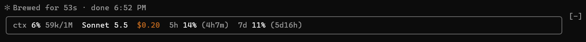
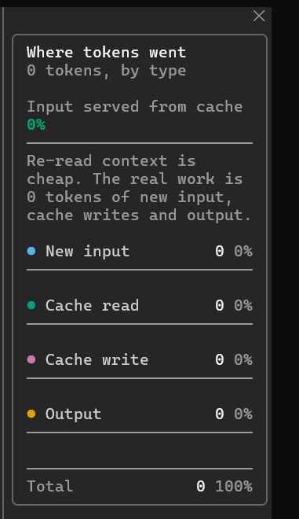

<div align="center">

# 🧩 claude-code-mods

**Four small mods that make Claude Code cheaper and clearer to use.**

[](LICENSE)
[](#-the-mods)
[](https://claude.com/claude-code)
[](https://github.com/AneeqMalik/claude-code-mods)

[Quick start](#-quick-start) · [The mods](#-the-mods) · [auto-model](#-auto-model) · [Contributing](#-contributing)

</div>

---

## ✨ Why

Claude Code is configurable, but the defaults leave money and context on the table. These mods fix the things I kept hitting:

- 💸 Every turn ran on one model, even when Haiku would do.
- 🔭 No live view of context, cost, rate limits or cache usage.
- 🗑️ MCP servers I never called still cost tokens at startup.

Each mod is independent. Install only the ones you want.

## 🚀 Quick start

Add the marketplace once:

```
/plugin marketplace add AneeqMalik/claude-code-mods
```

Then install only the mods you want, one at a time:

```
/plugin install auto-model@claude-code-mods
/plugin install usage-status@claude-code-mods
/plugin install token-usage@claude-code-mods
/plugin install trim-startup-context@claude-code-mods
```

Mods are independent, so any combination works. `usage-status` shows the routed model when `auto-model` is also installed, but needs nothing from it.

## 🧰 The mods

| | Mod | What it does | Command |
| :-: | --- | --- | --- |
| 🔀 | [**auto-model**](#-auto-model) | Routes each turn to Haiku, Sonnet or Opus by workload, switching only when the cache re-write pays off. | `/auto-model` |
| 📊 | [**usage-status**](#-usage-status) | A pill above the prompt: model, context, cost, rate limits. Auto-compacts at 250k. | |
| 🪙 | [**token-usage**](#-token-usage) | A live pane charting input, output and cache tokens. | `/tokens` |
| ✂️ | [**trim-startup-context**](#%EF%B8%8F-trim-startup-context) | Finds and denies MCP servers you never use. | `/trim-context` |

---

## 🔀 auto-model

Most turns don't need your biggest model. A Haiku classifier labels each prompt *simple*, *moderate* or *complex* and routes it to Haiku, Sonnet or Opus.

The catch: **switching models invalidates the prompt cache.** So a downgrade only happens when the cheaper model repays the cache re-write within a few turns. Upgrades are always allowed. If you pick a model with `/model`, auto-model steps aside.

| Command | Effect |
| --- | --- |
| `/auto-model` | Show status and recent routing |
| `/auto-model on` · `off` | Enable or pause routing |
| `/auto-model haiku` · `sonnet` · `opus` | Pin one tier |
| `/auto-model set <tier> <id>` | Use an exact model ID for a tier |
| `/auto-model reset` | Clear ID overrides |

<details>
<summary><b>Model IDs: nothing is tied to one release</b></summary>

For each tier the ID is, in order:

1. your `set` override;
2. your session's current ID with the family swapped (`claude-opus-6-0` becomes `claude-haiku-6-0`);
3. a built-in default in `hooks/lib.ts`.

If a derived ID is refused before any output, the turn retries once on the built-in ID.

The cost model (relative prices, expected turns per switch) uses assumptions in `hooks/lib.ts`, not billing data. Adjust them to your plan.
</details>

## 📊 usage-status

<p align="center"></p>

A pill above the prompt showing the current model, context used, session cost and rate-limit usage with time to reset. It turns to a warning state at 80% and auto-compacts the conversation at 250k tokens. With auto-model installed, it shows the model actually sent and notices when you change it with `/model`.

## 🪙 token-usage

<p align="center"></p>

`/tokens` opens a narrow pane beside the transcript charting this session's tokens in four colourblind-safe series: **new input**, **cache read**, **cache write** and **output**, updated turn by turn.

## ✂️ trim-startup-context

MCP servers add their tool schemas to every session's startup context, used or not. This mod scans your last 30 session transcripts for servers that are loaded but never called. With at least 5 sessions of history, it denies them for the current project automatically.

```
/trim-context           show unused servers and the tokens they cost
/trim-context apply     deny them in this project
/trim-context undo      revert, and stop auto-trimming this project
```

---

## 🤝 Contributing

Issues and PRs welcome. Keep each mod small, tested and independent.

## 📄 License

[MIT](LICENSE) © Aneeq Fayyaz Karim Malik
